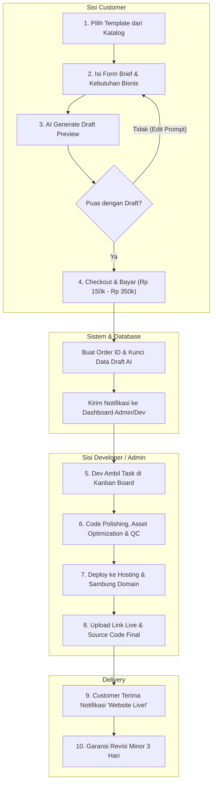
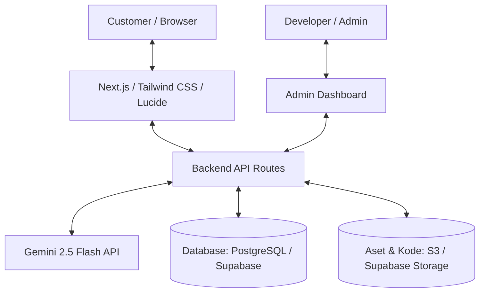
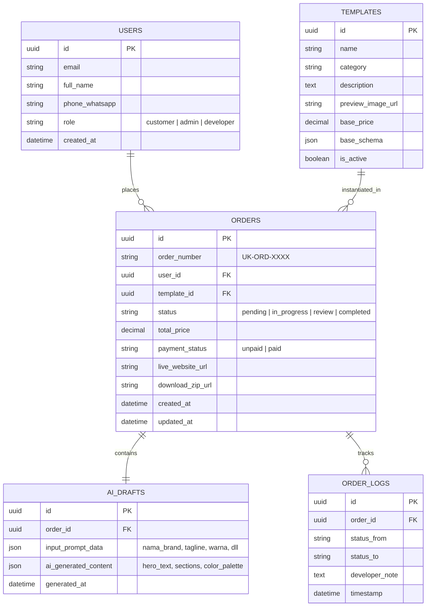

# Dokumen Perencanaan Komprehensif: B2C AI-Assisted Template Customization Service (Tugas UAS)

---

## 1. Executive Summary & Value Proposition

### 1.1 Latar Belakang Masalah
Banyak pelaku UMKM, pemilik bisnis pemula, dan profesional membutuhkan website profesional secara cepat dan terjangkau, namun menghadapi dua kendala utama:
1. **Website Builder Mandiri (No-Code/DIY)**: Seringkali membingungkan bagi orang awam non-teknis, butuh waktu belajar, dan hasilnya kurang rapi.
2. **Software House / Agensi Web Tradisional**: Hasilnya berkualitas tinggi, namun biayanya sangat mahal (jutaan rupiah) dan pengerjaannya lambat (berminggu-minggu).

### 1.2 Solusi: *AI-Assisted Template Customization Service (Human-in-the-Loop)*
Platform ini menjembatani celah tersebut dengan konsep **Productized Service**:
- **Katalog Template Siap Pakai**: Pengguna memilih struktur dasar yang teruji.
- **AI-Powered Instant Customization**: AI menghasilkan draf teks, warna, struktur section, dan visual copywriting secara otomatis dalam hitungan detik berdasarkan brief bisnis customer.
- **Human Developer Execution & Quality Assurance**: Tim teknis manusia mengambil alih hasil draf AI, memvalidasi kerapian kode, mengoptimalkan SEO, performa aset gambar, dan menghubungkannya ke domain/hosting sampai **live** ke tangan customer.

---

## 2. Alur Bisnis B2C (End-to-End Workflow)



---

## 3. Fitur Utama & Kebutuhan Fungsional

### 3.1 Portal Customer (Front-End)
1. **Katalog & Filter Template**:
   - Filter berdasarkan industri (F&B / Kuliner, Creative Portfolio, Toko Online UMKM, Jasa Profesional, Event).
   - Mode Live Interactive Preview sebelum kustomisasi.
2. **AI Customizer Studio**:
   - Form input brief: Nama brand, target audiens, nilai keunggulan (USP), produk/layanan utama, preferensi palet warna, dan tone of voice (formal, ceria, mewah, santai).
   - Tombol **Generate with AI**: Memanggil AI untuk menghasilkan copywriting hero section, fitur, testimoni, FAQ, dan skema CSS.
   - Dual-pane interface: Form di sisi kiri, Live Preview Canvas di sisi kanan.
3. **Sistem Pemesanan & Checkout**:
   - Ringkasan paket layanan (Basic, Pro, Premium).
   - Input info kontak (WhatsApp & Email).
   - Mock payment / simulasi pembayaran (Virtual Account / QRIS).
4. **Order Tracking Dashboard**:
   - Timeline stepper status pesanan: `Draft AI` $\rightarrow$ `Pembayaran Diterima` $\rightarrow$ `Sedang Dikerjakan Developer` $\rightarrow$ `Quality Check` $\rightarrow$ `Live / Selesai`.
   - Direct chat / tiket bantuan ke developer.

### 3.2 Back-Office Tim Eksekutor (Admin / Developer)
1. **Kanban Board Order Management**:
   - Kolom status: *Backlog*, *In Progress*, *Need Review*, *Completed*.
2. **Developer Inspection Workspace**:
   - Akses detail brief asli customer.
   - Akses payload JSON hasil generate AI (teks, konfigurasi styling, gambar).
   - Tombol *Export Clean Source Code* (HTML/Tailwind siap pakai).
3. **Delivery Center**:
   - Input URL website yang sudah live (Vercel/Netlify/Custom Domain).
   - Upload file ZIP source code untuk customer.
   - Kolom catatan pengerjaan untuk customer.

---

## 4. Arsitektur Teknis & Tech Stack



| Layer | Pilihan Teknologi | Alasan Pemilihan |
| :--- | :--- | :--- |
| **Frontend Framework** | Next.js (App Router, TypeScript) / HTML5 + Tailwind | Komponen reaktif, cepat, ramah SEO, dan ekosistem modern. |
| **Styling & Icons** | Tailwind CSS + Lucide Icons | Desain UI rapi, modern, responsif mobile, dan cepat dikembangkan. |
| **AI LLM Engine** | Google Gemini API (`gemini-2.5-flash`) | Kecepatan latensi rendah, output JSON terstruktur, dan biaya terjangkau. |
| **Database & Auth** | Supabase (PostgreSQL) atau SQLite (Prisma ORM) | Skema relasional yang kuat untuk integritas data user & order. |
| **Deployment** | Vercel (Web App) + GitHub Actions | CI/CD otomatis, zero-config deployment. |

---

## 5. Perancangan Skema Database (Data Modeling)



---

## 6. Desain Prompt AI (Structured Prompt Engineering)

Untuk memastikan AI menghasilkan modifikasi template yang konsisten dan langsung bisa dirender oleh antarmuka, sistem menggunakan **JSON Structured Output**:

### System Prompt Template:
```text
Anda adalah asisten AI arsitek web profesional. Tugas Anda adalah memodifikasi template website standar sesuai dengan identitas bisnis yang diberikan oleh customer.

Berikan respon WAJIB dalam format JSON murni tanpa markdown pembungkus dengan struktur:
{
  "brand": {
    "name": "string",
    "tagline": "string",
    "about": "string"
  },
  "theme": {
    "primaryColor": "hex code",
    "accentColor": "hex code",
    "fontPairing": "string"
  },
  "heroSection": {
    "badge": "string",
    "headline": "string",
    "subheadline": "string",
    "ctaText": "string"
  },
  "features": [
    {"icon": "string", "title": "string", "description": "string"},
    {"icon": "string", "title": "string", "description": "string"},
    {"icon": "string", "title": "string", "description": "string"}
  ],
  "faq": [
    {"q": "string", "a": "string"},
    {"q": "string", "a": "string"}
  ]
}
```

---

## 7. Rencana Roadmap Pengerjaan (UAS Timeline)

| Milestone | Durasi | Target Capaian (Deliverables) |
| :--- | :--- | :--- |
| **Milestone 1: Perencanaan & Prototype HTML** | Hari 1–2 | - Dokumen PLAN.md lengkap<br>- Prototype antarmuka interaktif (index.html) |
| **Milestone 2: Integrasi AI Generator Aktif** | Hari 3–4 | - Sambungan API Gemini untuk dynamic prompting<br>- Live render template secara modular |
| **Milestone 3: Sistem Order & Database** | Hari 5–6 | - Skema tabel database (Users, Orders, Drafts)<br>- Flow checkout dan tracking nomor pesanan |
| **Milestone 4: Workspace Admin / Developer** | Hari 7–8 | - Dashboard tim untuk memproses antrean order<br>- Fitur update status & delivery URL |
| **Milestone 5: Pengujian, Laporan & Presentasi** | Hari 9–10 | - Pengujian alur End-to-End<br>- Penyusunan laporan UAS dan video demo aplikasi |

---

## 8. Rubrik Penilaian UAS & Kriteria Sukses

1. **Kelayakan Solusi B2C**: Memiliki alur bisnis yang realistis dan jelas bagi end-user (bukan sekadar proyek dummy).
2. **Kecanggihan Pemanfaatan AI**: AI tidak hanya berupa chat biasa, melainkan bertindak sebagai *co-creator* yang memodifikasi artefak web secara dinamis.
3. **Nilai Human-in-the-Loop**: Menunjukkan kontrol kualitas manusia yang menjamin hasil akhir tidak mengalami halusinasi dan layak online.
4. **Kesiapan Demonstrasi**: Memiliki demo visual yang mulus dari pemilihan template hingga pesanan siap tayang.
